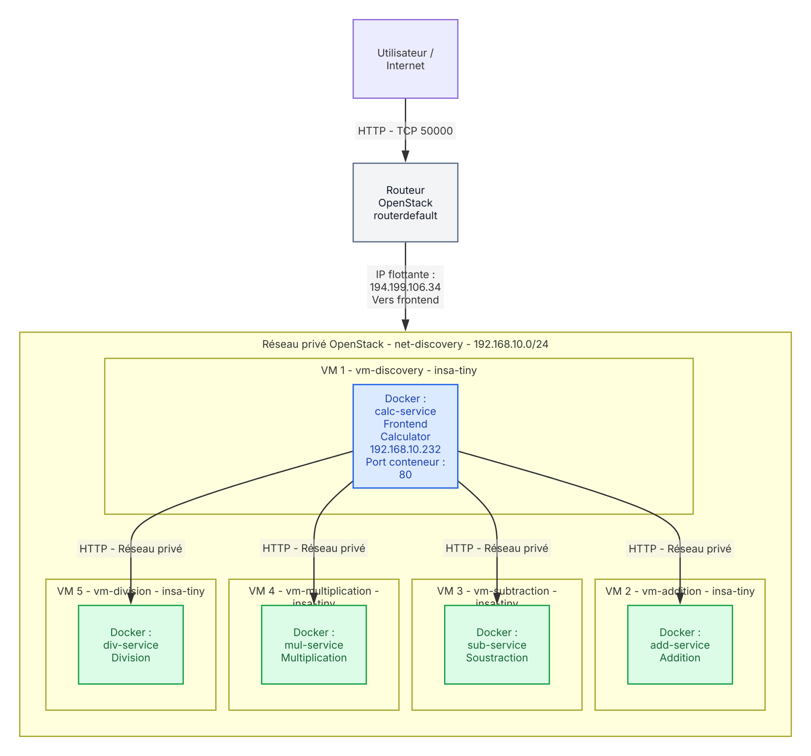

# TP3

## Étape 1 — Architecture de la plateforme



## Étape 2 — Déploiement des services

**1. Quels sont les différents rôles de la VM connectée à Internet dans votre architecture ?**

- **Point d'entrée** : elle héberge le frontend (`calc-service`) et porte l'IP flottante, c'est la seule VM joignable depuis Internet.
- **Bastion / proxy SSH** : c'est par elle (`ProxyJump`) qu'on accède aux VM du réseau privé, qui n'ont pas d'IP flottante.
- **Passerelle applicative** : elle relaie les requêtes des utilisateurs vers les services internes (addition, soustraction, multiplication, division), ce qui évite de les exposer.

**2. Quels avantages apporte ce déploiement par rapport à une exécution de tous les services sur une seule machine ?**

- **Isolation** : la panne ou la compromission d'un service n'affecte pas les autres.
- **Sécurité** : seule une VM est exposée, les services internes restent dans un réseau privé (surface d'attaque réduite).
- **Scalabilité** : chaque service peut être redimensionné ou dupliqué indépendamment, selon sa charge.
- **Ressources dédiées** : un service gourmand ne prive pas les autres de CPU/RAM.
- **Maintenance** : on peut mettre à jour ou redémarrer un service sans interrompre les autres.

## Étape 3 — Communications

**1. Quels flux réseau sont nécessaires au fonctionnement de votre application ?**

| Source       | Destination                     | Protocole / port                                   | Usage                        |
| ------------ | ------------------------------- | -------------------------------------------------- | ---------------------------- |
| Internet     | vm-discovery (calc-service)     | TCP 50000 et 5000 (HTTP, redirigés vers le 80 du conteneur) | Requêtes des utilisateurs    |
| vm-discovery | vm-addition (sum-service)       | TCP 50001                                          | Addition                     |
| vm-discovery | vm-substraction (sub-service)   | TCP 50002                                          | Soustraction                 |
| vm-discovery | vm-multiplication (mul-service) | TCP 50003                                          | Multiplication               |
| vm-discovery | vm-division (div-service)       | TCP 50004                                          | Division                     |
| Poste admin  | vm-discovery, puis VM privées   | TCP 22 (SSH)                                       | Administration via ProxyJump |
| VM du groupe | VM du groupe                    | ICMP                                               | Tests (ping)                 |

Les flux internes sont limités au groupe de sécurité (et non au CIDR).

**2. Pourquoi est-il préférable d'ouvrir uniquement les ports nécessaires plutôt que d'autoriser tout le trafic ?**

C'est le principe du moindre privilège : chaque port ouvert est une porte d'entrée potentielle. En n'ouvrant que le strict nécessaire, on réduit la surface d'attaque, on empêche l'accès direct aux services internes, on limite la propagation d'une compromission d'une VM à l'autre, et on garde des règles lisibles et faciles à auditer.

**3. Pouviez-vous utiliser Docker Compose pour déployer les services sur toutes les VM en simultané ? Pourquoi ?**

Non. Docker Compose pilote les conteneurs d'**un seul hôte Docker** : il ne peut pas lancer des conteneurs sur plusieurs VM. Ici, chaque service tourne dans une VM différente (un conteneur par VM), il faut donc déployer VM par VM. Pour un déploiement multi-machines, il faudrait un orchestrateur (Docker Swarm, Kubernetes) ou un outil d'automatisation (Ansible, Terraform).

### Test de bout en bout

Le frontend (`calc-service`) est publié sur les ports 50000 et 5000 de `vm-discovery` (conteneur : port 80). Le port 50000 répond depuis l'intérieur d'OpenStack mais est filtré en amont depuis le VPN de l'université, alors que le port 5000 passe. Le test externe a donc été fait sur le port 5000 :

```bash
curl -v -X POST -d "2+3" http://194.199.106.34:5000
# result = 5
```

Les services internes ont été validés par `curl` depuis `vm-discovery` (ports 50001 à 50004, code 200), et les 4 opérations via un tunnel SSH (`ssh -N -L 8080:localhost:50000 vm-discovery`) : 2+3=5, 7-4=3, 6*7=42, 8/2=4.